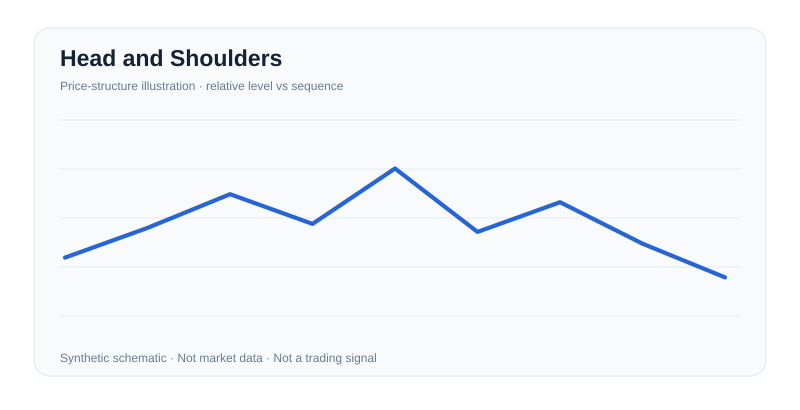
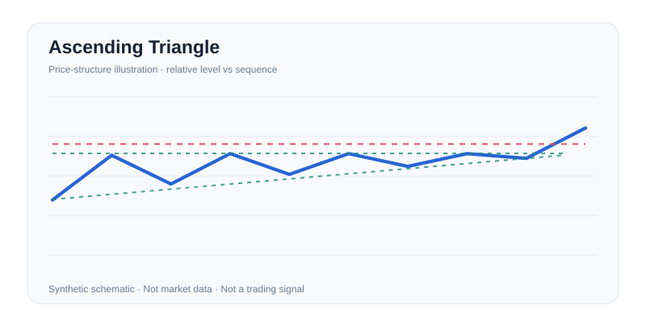
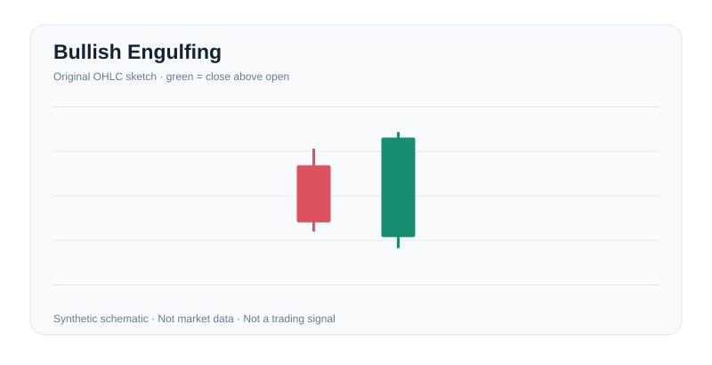
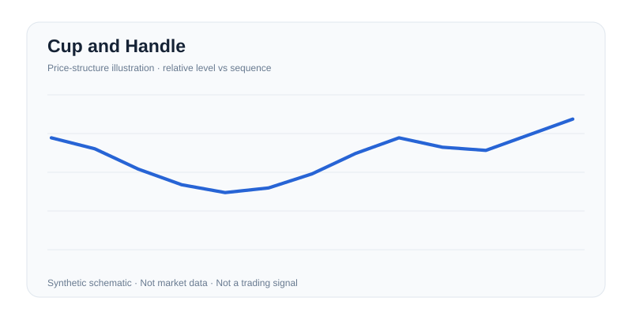

<div align="center">

# Market Analysis Atlas

**A reference skill for reasoning across charts, fundamentals, macro and market structure.**

[](https://agentskills.io/specification) [](https://www.python.org/)  [](LICENSE)

[Русская версия](README.ru.md) · [Skill](skills/market-analysis-atlas/SKILL.md) · [Terminology](docs/TAXONOMY.md) · [Coverage](docs/COVERAGE.md) · [Evidence](docs/METHODOLOGY.md)

</div>

---

## What it actually contains

| Component | Shipped | Not claimed |
|---|---:|---|
| Distinct **original, substantive English definitions** | **533** in 10 domains | The complete ~14,000-term Investopedia glossary |
| **Original SVG illustrations** | **100** (63 chart patterns + 37 candlesticks) | Copied Investopedia figures / empirical trading setups |
| Selected formulas | Embedded for well-specified concepts | Valid valuation without user inputs |
| Agent-readable guidance | 9 focused guides + 100 illustrated pattern cards + short `SKILL.md` | Guaranteed universal agent activation |
| Offline CLI search | Search and inspect JSONL; no dependencies | Full semantic neural search |
| Optional Investopedia title-link index | Robots-aware, opt-in script; **not run / not bundled** | Article text, article images or permission to mirror content |
| Validation | Offline structural checks + behavioral scenarios | Live model-performance benchmarks |

**Scope clarification:** The user-provided [Investopedia Financial Terms Dictionary](https://www.investopedia.com/financial-term-dictionary-4769738) spans finance far beyond charting, corporate analysis and macroeconomics. Investopedia says it maintains roughly 14,000 term definitions; its article prose and illustrations are copyrighted. This repo is an **original research-oriented knowledge base inspired by its topical breadth**, not an authorized full-text reproduction. Coverage is counted, not exaggerated. The optional title/URL indexer may be used only where the website's current rules permit access.

## Immediate use

```bash
# In your agent workspace, install via the skill ecosystem after publishing this folder on GitHub:
npx skills add KaigorodovTuskul/Market-Analysis-Atlas-Financial-Intelligence-Skill --skill market-analysis-atlas

# Or install from a checkout, with no network or extra Python packages:
python scripts/install.py --project /path/to/workspace --agent codex
python scripts/install.py --project /path/to/workspace --agent opencode
python scripts/install.py --project /path/to/workspace --agent claude-code

# Browse the references even without an agent:
python scripts/atlas.py "inverse head and shoulders" --detail
python scripts/atlas.py --category macro --limit 100
python scripts/atlas.py --stats
```

The root `AGENTS.md` offers a minimal fallback when a host does not discover `SKILL.md`. Do not install duplicate copies under multiple host paths unless you understand that host's lookup rules.

## Publishing and releases

The repository is plain files plus stdlib Python; there is no build step or server to deploy. To publish the first version:

```bash
git init
git add .
git commit -m "Release 1.0.0"
git branch -M main
git remote add origin https://github.com/KaigorodovTuskul/Market-Analysis-Atlas-Financial-Intelligence-Skill.git
git push -u origin main

# Optional: tag the release and publish a GitHub release
git tag -a v1.0.0 -m "Market Analysis Atlas 1.0.0"
git push origin v1.0.0
```

For a distributable archive, run `python scripts/package.py --output dist/market-analysis-atlas.zip`. `RELEASE_MANIFEST.json` records the release version, counts and SHA-256 checksums of the three core data files for provenance; it is not consumed at runtime. CI in `.github/workflows/ci.yml` re-runs validation and tests on every push and pull request.

## What the agent does

1. **Identify** the domain and look up a definition/formula, loading only the relevant reference.
2. **Ground** analysis in real inputs: dates, price timeframe, instrument, economic-release vintage, accounts, curves and market conditions.
3. **Validate** the observation against rival interpretations, counterexamples, convention choices and failure modes.
4. **Present** a compact evidence-led explanation, calculations when justified, and what remains unknown.

**It does not** turn a line drawing into guaranteed alpha; fabricate data; infer current prices from an offline glossary; treat all article links as verified; or automatically download third-party text/images.

## Example chart diagrams

<table>
<tr><td></td><td></td></tr>
<tr><td></td><td></td></tr>
</table>

All charts are independently generated, clearly labeled **synthetic** and excluded from actual market-performance evidence. To regenerate: `python skills/market-analysis-atlas/scripts/render_charts.py`.

## Tree

```text
market-analysis-atlas/
├── skills/market-analysis-atlas/
│   ├── SKILL.md                    Agent Skills entrypoint
│   ├── references/                 9 playbooks + 100 illustrated pattern cards
│   ├── data/terms.jsonl            533 original explanations, tags, formulas, caveats
│   ├── data/patterns.json          100 illustrative pattern manifests
│   ├── data/verified-links.json    Independently checked article URLs (small set)
│   ├── assets/charts/              100 reproducible original SVG images
│   └── scripts/render_charts.py    Zero-dependency SVG generator
├── scripts/
│   ├── atlas.py                    Offline CLI lookup
│   ├── sync_index.py               Optional, permission-respecting title/URL discovery
│   ├── import_titles.py            Import user-supplied title/source CSV
│   ├── install.py                  Safe, explicit local installer
│   ├── validate.py                 Offline package and chart audit
│   ├── package.py                  Reproducible release ZIP builder
│   └── build_seed.py               Hand-authored data source generator
├── tests/                          Python unit tests and scenario fixtures
├── docs/                           Coverage, research methods, licensing and guide
├── examples/                       Research workflows and scenario evaluations
└── .github/workflows/ci.yml        CI validation on supported Python versions
```

## Research with the glossary

```bash
# Show original explanation, formula (when available), caution, and diagram path:
python scripts/atlas.py "modified duration" --detail

# Machine-readable output suitable for an agent:
python scripts/atlas.py "inflation" --json --limit 30

# Get a broad topical inventory:
python scripts/atlas.py --category fundamentals --limit 200
```

Each curated record has a `term`, `category`, `definition`, `pitfall`, `provenance`, and `investopedia_index` pointing to the **alphabetical starting page**, not a guaranteed direct article. The verified direct links live separately in `data/verified-links.json`.

## How the optional external index works

The source dictionary is alphabetic. We verified that dedicated letter pages exist (A-D and Z sampled). To retrieve **titles/links only** (not the copyrighted articles or graphics):

```bash
# Remote access DISABLED by default. Review site terms/robots before using.
python scripts/sync_index.py --allow-site-fetch --letters abc --delay 3

# If permitted and successful, explicit full A-Z discovery:
python scripts/sync_index.py --allow-site-fetch --delay 3
python scripts/atlas.py "arbitrage" --include-index
```

`sync_index.py` checks robots.txt first and fails closed if it cannot verify the policy. It never bypasses authentication, CAPTCHA, blocks or rate limits and sleeps at least two seconds between requests. Review the terms of use separately: **robots permission is not copyright permission**. The report marks each index page `ok`, `robots_disallowed`, `fetch_failed` or `no_terms_or_layout_changed`, and only declares full alphabetical index coverage if all 26 letter pages parsed. It does **not** claim downloaded definitions. If the site prohibits your requested use, obtain a license or lawfully supplied glossary metadata instead:

```bash
python scripts/import_titles.py my_licensed_index.csv
# CSV columns: term,source_url
```

Importing metadata still does not generate the missing original descriptions. For an all-terms encyclopedic project, use a licensed open glossary or separately write and review all definitions.

## Validation

```bash
python scripts/validate.py
python -m unittest discover -s tests -v
```

Regeneration is deterministic; neither tests nor install nor offline lookup require network access. The tests verify consistency and selected semantic contracts, **not** real-world forecasting accuracy or automatic pattern recognition performance.

## Design choices

- The compact Agent Skills frontmatter and lazy-loaded references follow the organizational *style* of [Pareto Forge](https://github.com/KaigorodovTuskul/pareto-forge); no Pareto Forge source or brand assets are copied.
- Standard library only. CLI can be called by Codex, Claude Code, OpenCode, Cursor or other hosts, subject to their own execution policies.
- Accessible vector figures, JSONL instead of one enormous prompt, predictable IDs and a testable taxonomy.
- Deliberately no third-party price API keys, no execution endpoints, no investment advice claims.

## Rights, provenance and attribution

Original text/code/illustrations are licensed MIT. Investopedia and related trademarks belong to their owners. Links and topical inspiration do not imply endorsement, collaboration or rights to redistribute article contents. See [NOTICE](NOTICE.md), [Coverage](docs/COVERAGE.md), and [Methodology](docs/METHODOLOGY.md).

[Contributing](CONTRIBUTING.md) · [Security](SECURITY.md) · [Change log](CHANGELOG.md)
