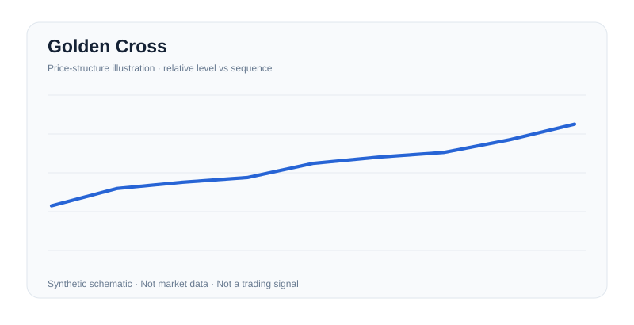

# Golden Cross

**Category:** `chart_patterns` · **Reading:** Conditional bullish setup · **Image type:** original synthetic schematic

## Original short explanation

Faster long-horizon moving average crosses above a slower one; lagging trend indicator.

## Evidence to request

Mark price pivots with a fixed lookback and tolerance; draw any relevant level or boundary from completed bars; require a stated close/volume rule to confirm the proposed transition.

## Invalidation / alternative

Pivots fail the pre-specified geometry, price returns inside the invalidated boundary, or follow-through is absent within the chosen expiry window.

## Risk and method

Shapes are subjective; test a deterministic pivot, breakout, volume and invalidation rule before interpreting them.

The diagram is an original teaching illustration, **not actual price data**, not an Investopedia figure and not empirical evidence that trading the shape is profitable. Detection thresholds, liquidity, instrument, timeframe and transaction costs must be specified before claiming performance.

## Further navigation

[General Investopedia alphabetic index; direct article not verified](https://www.investopedia.com/terms-beginning-with-g-4769357). Article contents are **not reproduced**. See [chart-pattern protocol](../patterns.md) and [evidence requirements](../evidence.md).
