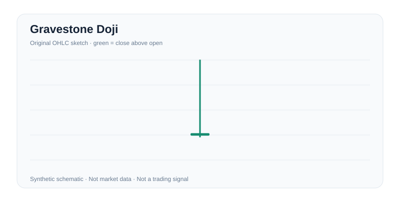

# Gravestone Doji

**Category:** `candlesticks` · **Reading:** Context-dependent / alternative interpretations required · **Image type:** original synthetic schematic

## Original short explanation

Open and close near period low with a long upper shadow, often studied near resistance.

## Evidence to request

Inspect open, high, low, close and the previous trend. Define real-body and wick ratios, gap policy and subsequent confirmation before assigning any signal.

## Invalidation / alternative

The candidate candle ratio is not met, the preceding trend is absent, or the next bars do not confirm the hypothesized change.

## Risk and method

One to three candles are weak standalone evidence; verify liquidity, timeframe, surrounding trend and follow-through.

The diagram is an original teaching illustration, **not actual price data**, not an Investopedia figure and not empirical evidence that trading the shape is profitable. Detection thresholds, liquidity, instrument, timeframe and transaction costs must be specified before claiming performance.

## Further navigation

[General Investopedia alphabetic index; direct article not verified](https://www.investopedia.com/terms-beginning-with-g-4769357). Article contents are **not reproduced**. See [chart-pattern protocol](../patterns.md) and [evidence requirements](../evidence.md).
